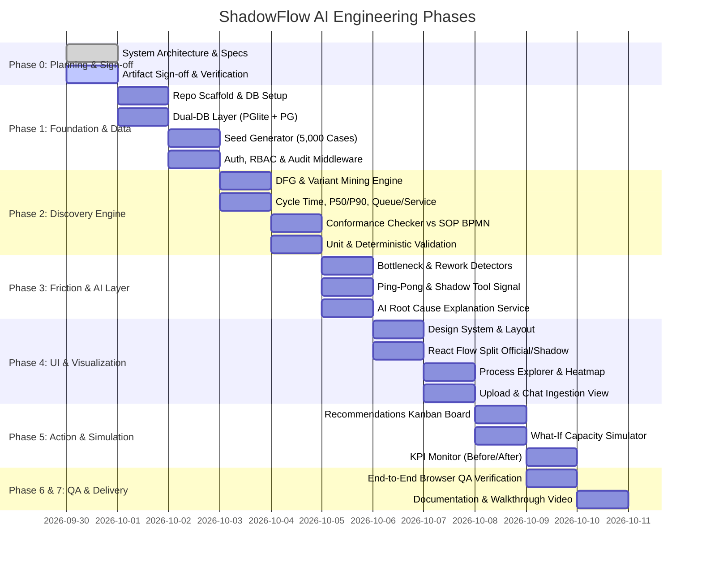

# ShadowFlow AI — Phase 0: Implementation Plan
**Hospital Operations Process Mining & Clinical Intelligence Platform**  
*Cosmic Surgical Hospital — "See how work really flows"*

---

## 1. Executive Summary & Objective

In modern surgical hospitals, a critical divergence exists between the **Official SOP/BPMN Workflow** (documented policies, accreditation checklists, electronic medical records) and the **Shadow Workflow** (ad-hoc workarounds, informal WhatsApp handoffs, duplicate paper logs, verbal clearances, and retroactive charting).

**ShadowFlow AI** is designed to reconstruct actual operational pathways across 8 critical perioperative workflows from raw event logs and unstructured communication. It quantifies friction (bottlenecks, ping-pong handoffs, repeat entries, compliance risks), explains root causes through an evidence-grounded AI reasoning engine, provides interactive "What-If" capacity simulations, and tracks operational KPIs on an actionable recommendation kanban.

---

## 2. Project Scope & Workflow Breakdown

ShadowFlow models **8 core workflows** at Cosmic Surgical across **11 operational roles**:

| # | Workflow Domain | Official SOP Path | Planted Shadow Variants & Friction | Key Handoff Roles |
|---|---|---|---|---|
| **W1** | **Patient Admission & Pre-Op Reg.** | Front Desk Registration → Triage Assessment → Insurance Desk Check → Admission Order Signed → Bed Allocation | Patient admitted before Triage; paper insurance slip hand-carried; duplicate entry in EMR and paper register. | Front Desk, Billing Executive, Ward Nurse |
| **W2** | **Pre-Anaesthetic Checkup (PAC) & Fitness** | OPD PAC Clinic → Lab/ECG Investigations → Cardiology Clearance (if indicated) → Fitness Certificate Issued → EMR Flag Updated | **Demo Highlight (38% cases):** OT booked *before* PAC clearance; anaesthetist chased via WhatsApp 2 hours pre-op; late-night verbal clearances leading to day-of-surgery delays and 8.4% cancellation spike. | Anaesthetist, Surgeon, Ward Nurse |
| **W3** | **OT Scheduling & Resource Allocation** | Master Schedule Drafted → Surgeon Request Locked → Anaesthesia Team Assigned → OT Room Allocated (T-24h) → Consumables Staged | Emergency bump-in without schedule re-balance; informal WhatsApp swap of OT rooms; surgeon block time overrun without notification. | Hospital Admin, OT Nurse, Surgeon, Anaesthetist |
| **W4** | **Pre-Op Checklist & Consent (WHO SSCL)** | Ward Pre-Op Checklist → Patient Identification Verified → Signed Informed Consent Verified → Sign-In (WHO Phase 1) | Sign-In conducted retroactively after patient draped; consent sheet physical scan missing in EMR; verbal allergy verification skipped in log. **(Clinical Risk Flag)** | Ward Nurse, OT Nurse, Anaesthetist, Surgeon |
| **W5** | **Intra-Op to PACU to Ward Transfer** | Time-Out (WHO Phase 2) → Surgical Procedure → Sign-Out (WHO Phase 3) → PACU Recovery Monitoring → Aldrete Score ≥9 → Ward Shift | Sign-Out logged post-surgery; PACU bed crunch causing OT table holding (idle wait: 28 min median); verbal handoff without Aldrete sign-off. | Surgeon, OT Nurse, Anaesthetist, Ward Boy, Ward Nurse |
| **W6** | **CSSD & Instrument Tray Turnaround** | Used Trays Decontaminated → Inspection & Packing → Autoclave Cycle (Biological Indicator) → Sterile Storage → OT Delivery | **Demo Highlight:** Tray indent entered on paper, EMR, and WhatsApp (3x duplicate entry); urgent flash sterilization done due to slow tracking; tray delivery delayed to OT. | CSSD Technician, OT Nurse, Ward Boy |
| **W7** | **Pharmacy & Consumables Indent** | OT Indent Placed in EMR → Pharmacy Dispense Verification → Batch/Lot Scan → OT Handover → Charge Sheet Reconciled | Stat emergency drugs pulled from emergency kit without indent; paper slip written; batch numbers reconciled 12 hours later; duplicate debit reversals. | OT Nurse, Pharmacist, Billing Executive |
| **W8** | **Billing, Insurance Pre-Auth & Discharge** | Surgery Completed → Implant Sheet Attached → Pre-Auth Query Response → Final Bill Generated → Payer Approval → Discharge Summary Handover | **Demo Highlight:** Pre-auth query sits for 6+ hours waiting for histopath/implant stickers already uploaded during admission; discharge delayed by 5.2 hours average. | Billing Executive, Quality Head, Ward Nurse |

---

## 3. Phased Implementation Roadmap

### Detailed Phase Milestones

- **Phase 0 (Current): Plan & Align**
  - Produce Implementation Plan, Architecture Specification, ERD / Data Model, Assumptions & Open Questions.
  - Secure explicit user approval before generating code.

- **Phase 1: Foundation & Data Infrastructure**
  - Scaffold Monorepo / Fullstack application (`client` + `server` in clean modern TypeScript).
  - PostgreSQL schema implementation with seamless Dual-Mode execution:
    - Default local mode: `@electric-sql/pglite` (real in-process PostgreSQL engine via WebAssembly, zero external daemon requirement, 100% Postgres SQL dialect, zero friction for instant one-command run).
    - Production mode: Standard `pg` client connecting to external PostgreSQL or Supabase instance via `DATABASE_URL`.
  - Realistic Synthetic Seed Generator: 5,000 surgical cases (over 65,000 events) across all 8 workflows spanning 90 days of hospital operations.
  - Strict Healthcare Guardrails: Tokenized anonymous patient identifiers (`CASE-XXXX`), role-aggregated operational metrics, DPDP/HIPAA data minimization, RBAC (11 roles), and immutable audit logging.

- **Phase 2: Process Discovery & Conformance Engine**
  - Deterministic Process Mining in pure TypeScript/Node.js:
    - **Directly-Follows Graph (DFG)**: Matrix of transitions $(A \rightarrow B)$ with occurrence counts, transition probabilities, median durations, and P90 durations.
    - **Trace Variant Clustering**: Extraction and grouping of unique event sequences; calculation of Pareto distributions (top 5 variants covering 80% volume vs long-tail shadow variants).
    - **Queue Time vs. Service Time**: Disentangling waiting time (idle time in buffer) from active service time.
    - **Conformance Checking**: Token-based replay and alignment comparison against official SOP graph. Detection of:
      - *Skipped Required Steps* (e.g. Consent missing prior to incision)
      - *Reordered Steps* (e.g. OT booking prior to PAC clearance)
      - *Unofficial Shadow Steps* (e.g. "WhatsApp Verification Requested")
      - *Off-System Channels* (paper registers, personal spreadsheet indents)

- **Phase 3: Friction Detectors & Grounded AI Reasoning Layer**
  - Algorithmic Friction Detectors:
    - *Bottleneck Detector*: Steps where $P90 / P50 > 3.0$ or queue time accounts for $> 70\%$ of step cycle time.
    - *Rework Loop Detector*: Same activity occurring $\ge 2$ times within single case trajectory, or identical data payload entered across multiple channels (e.g. CSSD indent).
    - *Ping-Pong Handoff Detector*: Role handoff cycles $(R_1 \rightarrow R_2 \rightarrow R_1)$ within short time horizons ($< 60$ minutes).
    - *Shadow Tool Detector*: Identification of channel tags `WhatsApp`, `Paper Slip`, `Excel`, `Verbal Handoff`.
  - AI Root Cause & Recommendation Service:
    - Pluggable LLM connector (OpenAI, Gemini, Anthropic, or Local/Offline Deterministic Fallback).
    - Hard Guardrail: AI receives calculated statistical metrics (frequencies, variant diffs, durations) and produces hypothesis explanations with explicit confidence scores and traceable evidence lists. Never invents synthetic numbers or executes ungrounded arithmetic.
    - Clinical Safety Disclaimers: Prominent "Clinical Decision Support Only" badge on all AI explanations.

- **Phase 4: High-Fidelity UI & Cosmic Theme**
  - Dark, calm, clinical-cosmic aesthetic: Deep Navy (`#0B0F19`, `#111827`), Teal/Cyan accents (`#06B6D4`, `#14B8A6`), Soft Violet (`#8B5CF6`), Amber warnings (`#F59E0B`), and Red strictly reserved for patient safety risks (`#EF4444`).
  - Signature Split View: Dual React Flow Canvas comparing Official Workflow (crisp solid links) vs. Shadow Workflow (luminescent dashed links, thickness = frequency, colour = P90 latency).
  - Department $\times$ Hour Bottleneck Heatmap, Process Explorer with trace filtering, Ingestion & File Upload Hub.

- **Phase 5: Recommendations Kanban, What-If Simulator & KPI Monitor**
  - Recommendation Board: Interactive 4-column Kanban (`Proposed`, `Approved`, `In Progress`, `Measured`) with impact scoring (hours saved/month, INR cost reduction, safety score improvement).
  - What-If Simulator: Monte Carlo / Discrete event capacity simulator calculating shift in OT utilization, turnover time, and bottleneck relaxation based on interventions (e.g. adding 1 CSSD tech, digitizing PAC clearance).
  - Before/After KPI Monitor: Tracking key surgical metrics across hospital baseline vs. intervention cohorts.

- **Phase 6: Verification & End-to-End QA**
  - Automated browser subagent verification executing user flows, capturing screenshots, and recording video artifact.
  - Full automated unit tests covering DFG generation, conformance metrics, and friction detection algorithms.

- **Phase 7: Final Documentation & Production Deliverables**
  - Complete README, `.env.example`, 3-minute executive demo walkthrough script, and one-page clinical-ops executive brief.

---

## 4. Mathematical Formulations for Discovery Engine

### 4.1 Directly-Follows Graph (DFG)
Let an event log $L$ be a multiset of traces $\{ \sigma_1, \sigma_2, \dots, \sigma_N \}$, where each trace $\sigma = \langle e_1, e_2, \dots, e_k \rangle$ is a chronological sequence of events belonging to a single surgical `case_id`.

Each event $e_i$ is defined as a tuple:
$$e_i = (a_i, t_i^{start}, t_i^{end}, r_i, d_i, c_i, s_i)$$
where $a_i$ is activity name, $t$ is timestamp, $r$ is role, $d$ is department, $c$ is channel, and $s$ is system used.

The directly-follows relation $>_L$ over activities $A$ is defined by:
$$a >_L b \iff \exists \sigma = \langle e_1, \dots, e_k \rangle \in L, \exists i \in [1, k-1]: a_i = a \land a_{i+1} = b$$

Frequency of edge $(a, b)$:
$$F(a, b) = \sum_{\sigma \in L} |\{ i \in [1, |\sigma|-1] : a_i = a \land a_{i+1} = b \}|$$

Transition duration for transition $(e_i \rightarrow e_{i+1})$:
$$\Delta t(e_i, e_{i+1}) = t_{i+1}^{start} - e_i^{end}$$

### 4.2 Conformance Metric (Fitness & Precision)
Given an Official SOP model represented as a directed graph $M = (V_{SOP}, E_{SOP})$:
- **Missing Required Steps:**
  $$\text{Skipped}( \sigma ) = \{ v \in V_{SOP}^{required} \mid v \notin \sigma \}$$
- **Unofficial Transitions:**
  $$\text{UnofficialEdges}( \sigma ) = \{ (a_i, a_{i+1}) \mid (a_i, a_{i+1}) \notin E_{SOP} \}$$
- **Case Conformance Score:**
  $$\text{Score}(\sigma) = 1.0 - \left( w_1 \cdot \frac{|\text{Skipped}(\sigma)|}{|V_{SOP}^{required}|} + w_2 \cdot \frac{|\text{UnofficialEdges}(\sigma)|}{|\sigma|-1} + w_3 \cdot \mathbb{I}(\text{OffSystem}) \right)$$
  *(normalized to $[0, 100\%]$)*

### 4.3 Queue Time vs. Service Time
For activity $a$ in trace $\sigma$:
$$\text{Service Time}(e_i) = t_i^{end} - t_i^{start}$$
$$\text{Queue Time}(e_i) = t_i^{start} - t_{i-1}^{end}$$
$$\text{Bottleneck Ratio}(a) = \frac{\text{Median Queue Time}(a)}{\text{Median Service Time}(a)}$$
A step is flagged as a systemic bottleneck when $\text{Bottleneck Ratio}(a) > 2.5$ and aggregate wait $> 30\text{ min}$.

---

## 5. Verification & Testing Strategy

1. **Deterministic Mining Tests**:
   - Fixture with 10 synthetic traces having known variants. Verify DFG edge counts, P50/P90 calculations match exact analytical values.
2. **Planted Demo Assertions**:
   - Verify that in the generated dataset:
     - Exactly $38\% \pm 2\%$ of W2/W3 cases feature OT booking prior to PAC clearance.
     - CSSD tray indents exhibit a rework frequency of 3.0.
     - Billing pre-auth waiting time for admission clinical notes averages $6.0 \pm 0.5$ hours.
3. **RBAC & Data Masking Tests**:
   - Verify no PII (names, phone numbers, raw IDs) is serialized in API responses.
   - Verify audit log captures every event log upload, graph query, and recommendation export.
4. **Browser Subagent Walkthrough**:
   - Launch Chromium, navigate through all views (Overview, Process Explorer, Conformance, Heatmap, Insights, Kanban, Simulator, KPI Monitor), verify zero console errors, verify responsive layout, and record interaction artifact.
